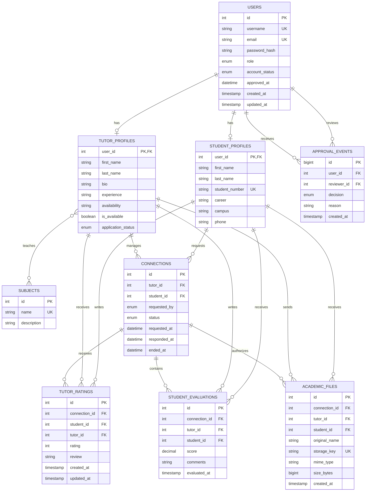

# EduMatch Data Model

## Purpose

This document describes the relational data model used by EduMatch. The executable
MySQL schema is available in [`backend/sql/schema.sql`](../backend/sql/schema.sql).

EduMatch connects approved students and tutors, supports academic file delivery,
and separates tutor ratings from tutor evaluations of students. The platform does
not include internal messaging or chat.

## Entity relationship diagram

## Tables and responsibilities

| Table | Responsibility |
| --- | --- |
| `users` | Authentication, role, and account approval state |
| `student_profiles` | Student-specific academic and contact information |
| `tutor_profiles` | Tutor biography, experience, availability, and application state |
| `subjects` | Catalog of academic subjects |
| `tutor_subjects` | Many-to-many relationship between tutors and subjects |
| `tutor_student_connections` | Student-tutor requests and accepted relationships |
| `tutor_ratings` | Student ratings assigned to tutors, from 1 to 5 |
| `student_evaluations` | Tutor evaluations assigned to students, from 0 to 100 |
| `academic_files` | Metadata for files sent by tutors to accepted students |
| `approval_events` | Administrator history for approval and account decisions |

## Main business rules

1. Only approved accounts can access their full role capabilities.
2. A tutor must have an approved tutor profile and can be shown in search only when
   `is_available = TRUE`.
3. A file can only be sent from a tutor to a student through their connection.
4. A student rating evaluates a tutor; it is not the same as a student evaluation.
5. Ratings, evaluations, and files must be authorized against an existing
   student-tutor connection in the backend.
6. Passwords are stored as hashes, never as plain text.
7. The database has no message, conversation, or chat entity.

## Why there are both Markdown and SQL files

- This Markdown file explains the model for the team, documentation, reviews, and
  presentations.
- [`backend/sql/schema.sql`](../backend/sql/schema.sql) creates the actual MySQL
  tables, indexes, foreign keys, and constraints.

The two files should be updated together whenever the data model changes.
