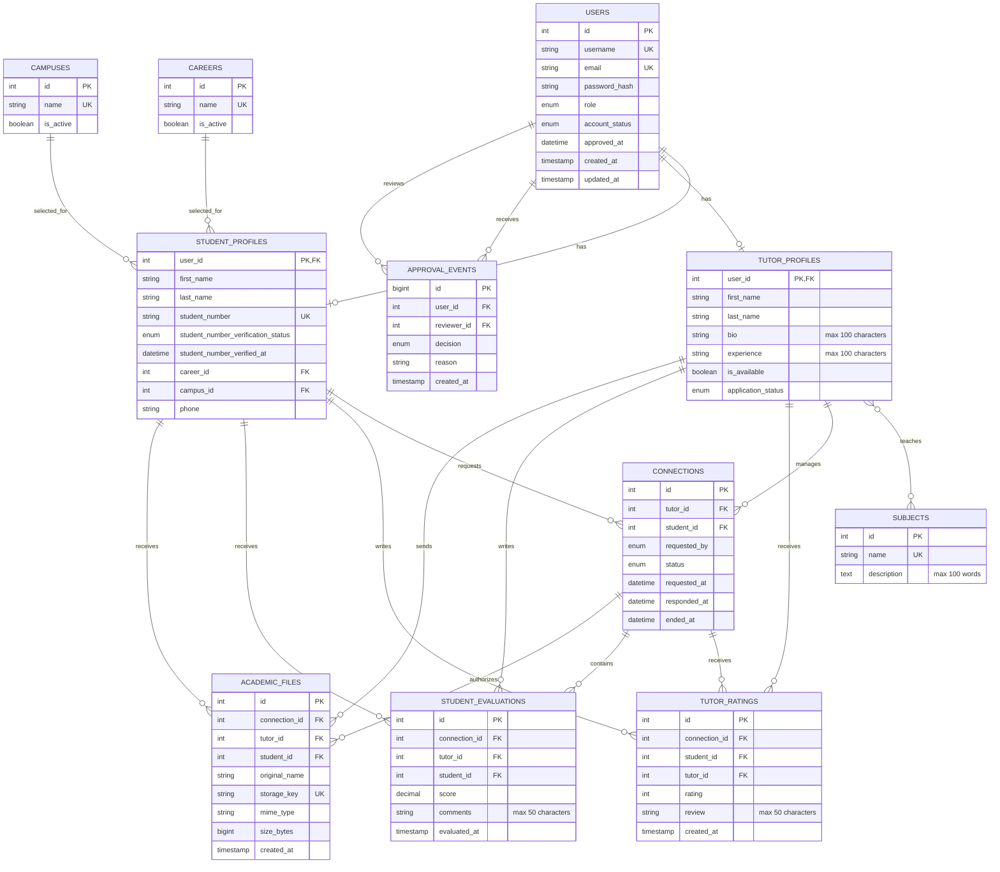

# EduMatch Data Model

## Purpose

This document describes the relational data model used by EduMatch. The executable
MySQL schema is available in [`backend/sql/schema.sql`](../backend/sql/schema.sql).

EduMatch connects approved students and tutors, supports academic file delivery,
and separates tutor ratings from tutor evaluations of students. The platform does
not include internal messaging or chat.

## Entity relationship diagram

## Tables and responsibilities

| Table | Responsibility |
| --- | --- |
| `users` | Authentication, role, account approval state, username, and email |
| `careers`, `campuses` | Authoritative catalogs used by student profiles; only active entries are selectable |
| `student_profiles` | Student-specific academic/contact information and enrollment verification state |
| `tutor_profiles` | Tutor biography, experience, availability flag, and application state |
| `subjects` | Catalog of academic subjects; names are preserved and descriptions are limited to 100 words |
| `tutor_subjects` | Many-to-many relationship between tutors and subjects |
| `tutor_student_connections` | Student-tutor requests and accepted relationships |
| `tutor_ratings` | Student ratings assigned to tutors, from 1 to 5 |
| `student_evaluations` | Tutor evaluations assigned to students, from 0 to 100 |
| `academic_files` | Metadata for files sent by tutors to accepted students |
| `approval_events` | Administrator history for approval and account decisions |

## Main business rules

1. Only approved accounts can access their full role capabilities.
2. A tutor must have an approved tutor profile and can be shown in search only when
   `is_available = TRUE`.
3. A file can only be sent from a tutor to a student through their connection.
4. A student rating evaluates a tutor; it is not the same as a student evaluation.
5. Ratings, evaluations, and files must be authorized against an existing
   student-tutor connection in the backend.
6. Passwords are stored as hashes, never as plain text.
7. The database has no message, conversation, or chat entity.
8. Usernames and profile names contain letters only; emails must have a valid structure, contain no whitespace, and remain unique.
9. Student numbers and phone numbers contain exactly 11 digits. Number uniqueness does not prove enrollment: verification must use an authoritative Universidad de Sonora source, and new numbers remain pending until that verification succeeds.
10. Career and campus selections reference active catalog entries. Legacy catalog values are retained as inactive until checked against official university data; catalog imports must not invent official values.
11. Tutor bio and experience are each limited to 100 characters. Tutor ratings and student evaluation comments are limited to 50 characters. Tutor ratings retain `created_at` but have no automatic update timestamp.
12. Administrator accounts use `users.role = 'admin'`; there is no separate password-bearing administrator table or public administrator registration. Provision the initial administrator through a controlled process outside the public application. Only authenticated administrators may modify student/tutor data or create approval events, enforced by backend authorization.

## Why there are both Markdown and SQL files

- This Markdown file explains the model for the team, documentation, reviews, and
  presentations.
- [`backend/sql/schema.sql`](../backend/sql/schema.sql) creates the actual MySQL
  tables, indexes, foreign keys, and constraints.

[`backend/sql/migrations/002_apply_profile_data_rules.sql`](../backend/sql/migrations/002_apply_profile_data_rules.sql) upgrades an existing database. The migration preserves legacy career/campus values as inactive catalog rows. Existing invalid student numbers, phone numbers, names, or overlength text must be reviewed and corrected before their new database constraints can be applied; never silently fabricate a verified enrollment number.

The documentation and SQL files should be updated together whenever the data model changes.